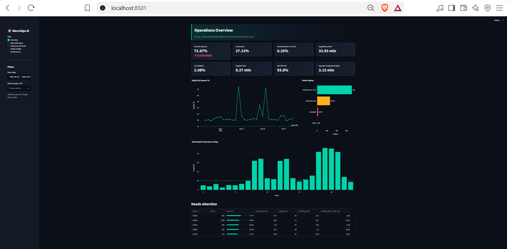

# MacroOps AI

GenAI-powered Fulfillment & Last-Mile Operations Intelligence Platform for quick-commerce operations (Blinkit / Zepto / Amazon-style dark stores).

**Phase 03 | MacroEdtech GenAI Research Internship**
Author: Tamanna | Mentor: Sagar Sakalley

All data in this repository is **synthetic** and generated for prototype, analytics and AI evaluation use. It must not be treated as real company data.

## What it does

| Module | Status |
|---|---|
| Data generation, profiling, master table | Done |
| EDA and KPI framework | Done |
| Streamlit Operations Dashboard | Done |
| SLA Risk Prediction (XGBoost + SHAP) | Next |
| RAG pipeline (LangChain + ChromaDB + HuggingFace + Ollama) | Planned |
| AI Operations Copilot (tool calling + memory) | Planned |
| Full MVP integration (FastAPI + dashboard) | Planned |

## Dashboard



Four pages: Overview, Store drill-down, Peak hours & trends, Picker & Rider performance. Filters for date range and store.

## Quick start (Windows / PowerShell)

```powershell
git clone https://github.com/tamanna26072/macroops-ai.git
cd macroops-ai
python -m venv .venv
.venv\Scripts\Activate.ps1
pip install -r requirements.txt

python -m src.generate_data     # creates the 5 CSVs in data/raw/
python -m src.build_master      # joins tables -> data/processed/master.parquet
python -m src.eda               # charts -> outputs/eda/
python -m src.kpi               # prints KPI report
streamlit run app/dashboard.py  # dashboard at localhost:8501
```

`data/` and `outputs/` are git-ignored. The generator uses a fixed seed (42), so every run produces the same dataset.

## Project structure

```
macroops-ai/
├── app/dashboard.py          Streamlit dashboard
├── src/
│   ├── config.py             paths
│   ├── generate_data.py      synthetic data generator (v2)
│   ├── data_loader.py        loads the 5 CSVs
│   ├── profile_data.py       schema, nulls, join checks
│   ├── build_master.py       joins tables, adds features, validation checks
│   ├── diagnose.py           label balance, timeline, signal test
│   ├── eda.py                EDA charts
│   └── kpi.py                KPI framework (reused by dashboard, API, copilot)
├── docs/                     screenshots, data dictionary, KPI definitions, decisions
├── .streamlit/config.toml    dark theme
└── requirements.txt
```

## Documentation

- [Data dictionary](docs/data_dictionary.md)
- [KPI definitions](docs/kpi_definitions.md)
- [Why dataset v2 was generated](docs/data_v2_decision.md)

## Tech stack

Python, Pandas, Plotly, Streamlit, XGBoost, SHAP, LangChain, ChromaDB, HuggingFace embeddings, Ollama, FastAPI, GitHub.